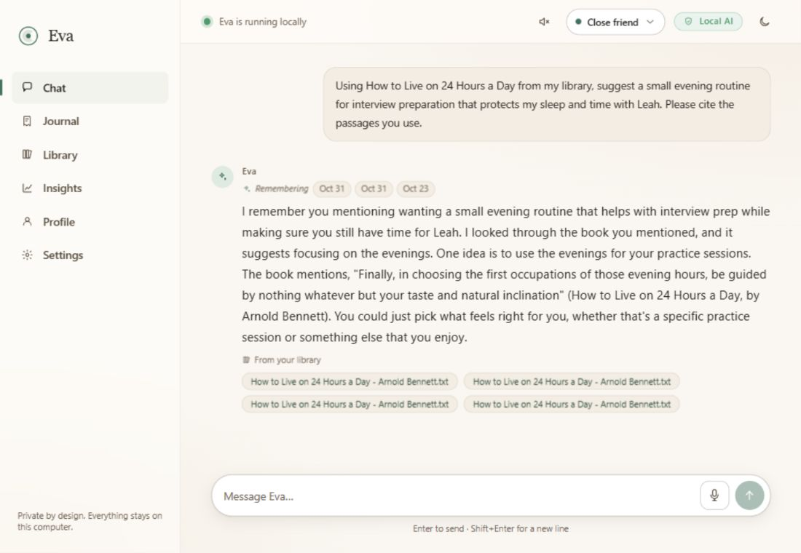
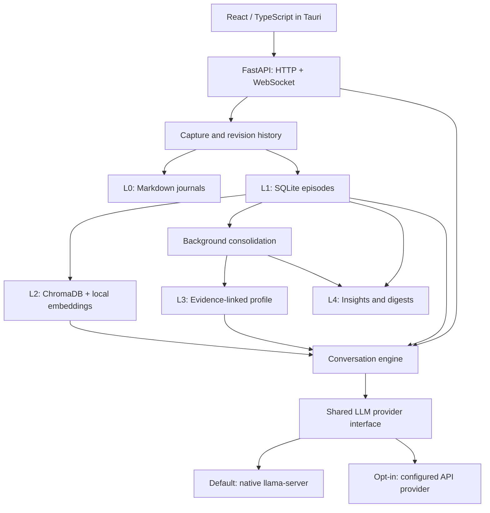

# Eva

**A private AI journaling companion with memory you can inspect, correct, and own.**

Eva turns journal entries and conversations into an evolving, evidence-linked
memory: what matters to you, what has changed, and what is still unresolved.
It runs a small language model locally by default, keeps your original writing
in plain Markdown, and lets you correct the profile it builds about you.

Built with **Tauri 2 · React · TypeScript · FastAPI · llama.cpp · SQLite · ChromaDB**.
with optional online providers
behind the same model interface.

[Demo](#see-eva-in-action) · [Architecture](#architecture) · [Engineering decisions](#engineering-decisions) ·
[Run locally](#run-locally) · [Explore the code](#explore-the-code)

> **Status:** Working prototype in active development. Chat, journaling, document
> retrieval, profile updates, and insights have implementations in this repository;
> voice is optional. Model-quality evaluation, target-device benchmarks, and
> production packaging remain ongoing work.

## See Eva in action



*A fictional persona, real local inference. Eighteen authored journal entries
flow through extraction, profile updates, and insights; later conversations
use the resulting memory and an uploaded reference library.*

Read the [illustrated walkthrough](docs/SHOWCASE.md) for the before-and-after
profile, original evidence, connections graph, mood chart, and reproducible
demo. The [recorded run](docs/showcase/run-record.json) links observed memory
changes to their source entries. The Windows source build was verified with
**433 passing backend tests**; target-device benchmarks remain separate work.

## What Eva does

| Capability | How it works |
| --- | --- |
| **Conversations with continuity** | Streams replies using recent entries, relevant older memories, and selected profile claims. Friend, coach, and mentor modes shape the conversation. |
| **A journal you own** | Saves full entries as Markdown, supports rich-text editing, and preserves previous versions when an entry changes. |
| **An editable understanding of you** | Tracks goals, patterns, relationships, and open loops with links to source entries. User corrections become protected anchors. |
| **Grounded reference answers** | Ingests PDF, Markdown, and text files into a separate library index; retrieves passages with citations for information and advice requests. |
| **Reflection over time** | Computes mood trends, relationship/theme graphs, and comparisons between periods from extracted journal data. |
| **Local voice** | Uses faster-whisper for speech input and Kokoro for sentence-by-sentence speech output. Voice dependencies are optional and models load on demand. |

For example, a new entry can resolve an earlier open loop. Background
consolidation can update its status with a pointer to that entry; later
conversations can retrieve the updated profile. Editing the supporting entry
triggers revalidation of affected claims.

## The challenge: continuity with a small local model

A small model has a limited working context. A useful companion still needs to
remember older experiences, update an unresolved concern when new evidence
arrives, and let the user correct an interpretation.

Eva implements that memory outside the model: durable originals, structured
episodes, semantic recall, evidence-linked profile operations, and derived
views. A fast read loop selects context for conversation; a background write
loop revises memory under deterministic validation rules. Model weights stay
fixed. The engineering work lies in persistence, retrieval, update policy,
concurrency, and making the result inspectable.

## Engineering decisions

Eva's central design choice is to put persistence, aggregation, and mutation
rules in software. The model handles extraction, interpretation, and language.

- **Preserve writing before inference.** Capture writes Markdown before updating
  derived stores. Failed extraction or embedding leaves the original entry
  intact. Stable entry IDs and source hashes support repair and recomputation.
  See [capture](backend/memory/capture.py) and [vault storage](backend/memory/vault.py).
- **Constrain memory updates.** The model proposes typed profile operations;
  deterministic code validates evidence IDs, applies confidence arithmetic,
  and protects user anchors. A valid source pointer enables inspection;
  semantic correctness still needs evaluation.
  See [profile operations](backend/memory/operations.py).
- **Make listening a control-flow decision.** The conversation engine only
  retrieves uploaded reference material for information or advice requests.
  Venting and processing turns can recall personal memories without pulling in
  library passages. See the [turn pipeline](backend/engine/turn.py).
- **Budget for a small laptop.** Local inference uses a quantized Gemma 4 E2B
  model, Metal offload, an 8,192-token server context, and q8_0 KV caches with
  flash attention. A shared model lock gives queued chat requests priority over
  background work; an already-running request finishes first.
  See the [server supervisor](backend/llm/server.py) and [model client](backend/llm/client.py).
- **Keep provider choice behind one boundary.** Native llama.cpp, existing local
  OpenAI-compatible servers, and opt-in hosted providers share streaming,
  completion, and status interfaces. Chat and memory processing use that same
  boundary. See [provider adapters](backend/llm/providers.py).
- **Expose what reached the model.** A local context inspector reports intent,
  retrieval decisions, selected memory, approximate token costs, and the
  assembled prompt. See the [inspection CLI](backend/eval/run.py).

## Architecture



The memory system has two loops: a conversational **read loop** selects context
for the current turn; a background **write loop** extracts episodes, revises
profile claims, and produces digests.

| Layer | Storage | Responsibility |
| --- | --- | --- |
| **L0 — Originals** | Markdown day files and revision history | Authoritative journal text, readable without Eva. |
| **L1 — Episodes** | SQLite | Structured summaries, emotions, events, goals, behaviors, and open loops. |
| **L2 — Recall** | ChromaDB + FastEmbed | Semantic indexes for journal summaries, episode units, and a separate reference corpus. |
| **L3 — User model** | `profile.json` + editable `profile.md` | Evidence-linked claims, confidence, status, and protected user corrections. |
| **L4 — Reflection** | Derived statistics, graph data, and digests | Descriptive views over recorded history. |

Here, **self-evolving memory** means updating external representations while
model weights stay fixed. Journal-derived indexes can be rebuilt from lower
layers; human corrections are additional inputs, so preserve profile artifacts
alongside journal files when backing up the vault.

The [technical paper](docs/EVA_MEMORY_TECHNICAL_PAPER.md) explains the algorithms,
implementation evidence, limitations, and proposed evaluation protocol.

## Privacy and data ownership

- **Local is the default.** After explicit model/embedding/voice setup, local
  mode runs without a hosted model API. No telemetry or usage analytics.
- **Backend network access is guarded.** A socket-level guard blocks
  non-loopback connections in local mode except an explicitly allowed setup
  download host. Online mode allows the configured provider host. This is a
  Python backend control, not an operating-system-wide network sandbox.
- **Online providers are opt-in.** Choosing one sends model inputs, including
  any selected journal or profile context, to that provider. Supported adapters
  include OpenAI-compatible APIs, Anthropic, and Gemini.
- **Original writing stays accessible.** The default vault is `local_vault/`
  (override with `EVA_VAULT_DIR`). Journals live under `journal/`; databases
  and vector indexes are derived representations.

Implementation: [network guard](backend/net_guard.py) ·
[privacy tests](backend/tests/test_privacy_audit.py) ·
[provider policy decision](docs/decisions/2026-07-01-hybrid-llm-provider.md).

## Run locally

The primary target is **macOS on Apple Silicon**. Use Python 3.11, Node.js 18+
with npm, and Homebrew. Rust is required for the native Tauri window; without
it, the development launcher serves the UI in a browser.

Run the following from the repository root. Dependency installation and model
downloads require internet access; they happen before offline runtime.

### 1. Install the core dependencies

```sh
brew install llama.cpp
python3.11 -m venv backend/.venv
backend/.venv/bin/python -m pip install -r backend/requirements.txt
npm --prefix ui ci
```

The local provider uses the native **`llama-server` binary only**. The Python
backend communicates with it over HTTP; no `llama-cpp-python` install is needed.

### 2. Download local model assets once

```sh
backend/.venv/bin/python scripts/download_model.py
backend/.venv/bin/python scripts/download_embed_model.py
```

The LLM download provides `models/gemma-4-E2B-it-qat-UD-Q4_K_XL.gguf`.
The embedding download is required for semantic recall and library ingestion,
including when using an online LLM provider. Its persistent cache lives under
the vault's `models/fastembed/` directory.

### 3. Launch Eva

```sh
./dev.sh
```

The launcher starts the backend at `http://127.0.0.1:8000` and the Tauri window
(or Vite at `http://localhost:1420`). It sets `EVA_START_LLAMA=1` so the backend
launches and supervises `llama-server` on `127.0.0.1:11500`; you do not need to
start the model server separately. Check `http://127.0.0.1:8000/health` for readiness.

To use another provider, open Eva's AI settings and explicitly select it.
Online LLM mode does not require the local GGUF download.

<details>
<summary><strong>Optional: enable local voice</strong></summary>

Install the separate voice dependencies and download their assets:

```sh
brew install espeak-ng
backend/.venv/bin/python -m pip install -r backend/requirements-voice.txt
backend/.venv/bin/python scripts/download_whisper_model.py all
backend/.venv/bin/python scripts/download_kokoro_model.py
```

Voice models load on demand. Keeping them out of the core install avoids the
additional PyTorch dependency for text-only use. Audio decoding uses PyAV;
a separate system ffmpeg installation is unnecessary.

</details>

<details>
<summary><strong>Windows source development</strong></summary>

Windows has setup and launcher scripts; Apple Silicon remains the primary
hardware target. With Python 3.11 and Node.js/npm installed, run from the repo
root in PowerShell:

```powershell
py -3.11 -m venv backend/.venv
.\backend\.venv\Scripts\python.exe -m pip install -r backend/requirements.txt
npm --prefix ui ci
powershell -ExecutionPolicy Bypass -File .\scripts\setup_windows.ps1
.\backend\.venv\Scripts\python.exe scripts/download_embed_model.py
powershell -ExecutionPolicy Bypass -File .\dev.ps1
```

The setup script downloads the GGUF and native llama.cpp runtime. Native Tauri
development also needs Rust and its Windows build prerequisites; otherwise the
launcher uses Vite in the browser.

</details>

## Verification and inspection

The backend includes tests for persistence, extraction, retrieval, profile
operations, consolidation, provider behavior, privacy controls, and failure
handling. Some checks mock the model; passing them does not establish response
quality or target-device performance.

From the repository root on macOS:

```sh
# Backend tests
(cd backend && .venv/bin/python -m pytest -q --basetemp ../.pytest-tmp)

# TypeScript check and production frontend build
npm --prefix ui run build

# Privacy smoke test: loopback allowed, external connection blocked
backend/.venv/bin/python scripts/check_net_guard.py

# Inspect a turn without generating a reply; uses your local vault
(cd backend && .venv/bin/python -m eval.run \
  --inspect "I have been feeling overwhelmed lately" --intent vent)
```

On Windows, run the backend suite from `backend/` with
`.\.venv\Scripts\python.exe -m pytest -q --basetemp ..\.pytest-tmp`.
Add `--model` to the inspector to also generate a reply using the selected
provider. Inspector output can contain private journal context.

## Explore the code

| Start here | What to look for |
| --- | --- |
| [Conversation engine](backend/engine/turn.py) | Intent classification, concurrent context assembly, retrieval gates, and streaming orchestration. |
| [Memory operations](backend/memory/operations.py) | Validated profile mutations, evidence requirements, confidence decay, and anchor protection. |
| [Consolidation](backend/memory/consolidate.py) | Nightly/weekly processing, claim revalidation, and temporal digests. |
| [Retrieval](backend/memory/retrieval.py) | Recent episodes, relevance/recency scoring, and reference citations. |
| [Provider adapters](backend/llm/providers.py) | A common contract across local and hosted model APIs. |
| [React UI](ui/src) | Chat, journal editor, profile evidence, library, insights, and settings. |
| [Backend tests](backend/tests) | Executable checks of storage, memory rules, network policy, and failure paths. |

For a deeper review, read the [memory systems paper](docs/EVA_MEMORY_TECHNICAL_PAPER.md)
and [evaluation design](docs/EVAL_HARNESS_DESIGN.md). The
[V2 implementation plan](docs/IMPLEMENTATION_PLAN_V2.md) and
[realignment notes](docs/V2_CODEBASE_REALIGNMENT_PLAN.md) record the development
sequence; their phase snapshots are historical rather than a current feature inventory.

## Current boundaries

- **Evaluation:** The context inspector is implemented. Controlled comparisons
  of recall, claim accuracy, and longitudinal personalization remain to be run.
  The technical paper records existing engineering validation separately.
- **Hardware:** The 8 GB M1 Air is the design target. Peak memory, swap activity,
  and end-to-end latency need measurement under the full workload, including voice.
- **Distribution:** The Rust shell is thin and packaging scripts/spikes exist.
  Production backend-sidecar integration, signing, and clean-machine verification
  remain release work.
- **Language:** English only.
