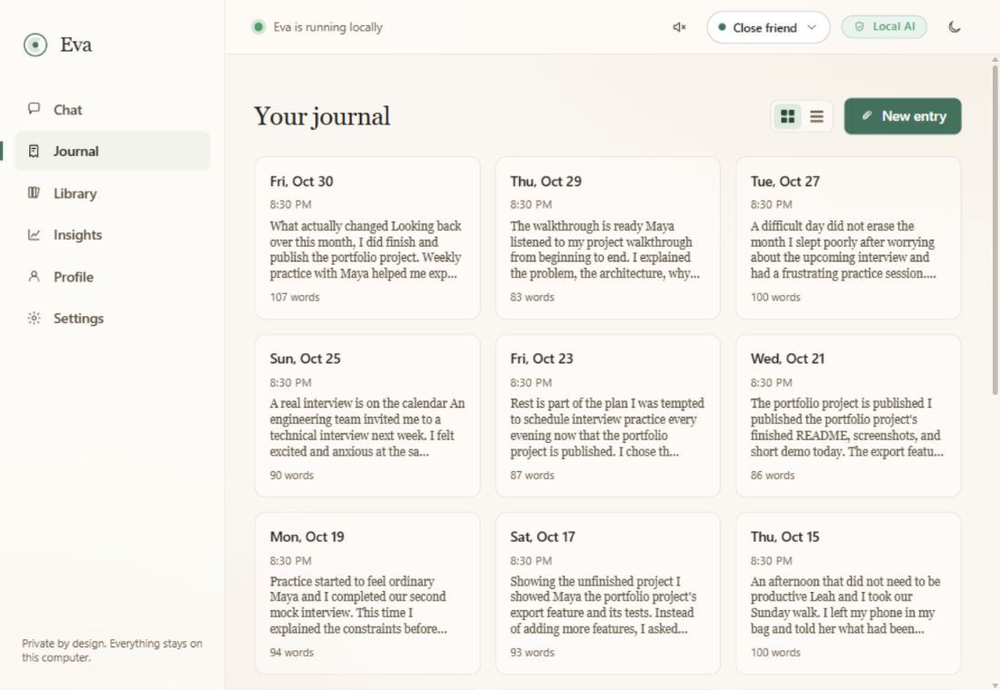
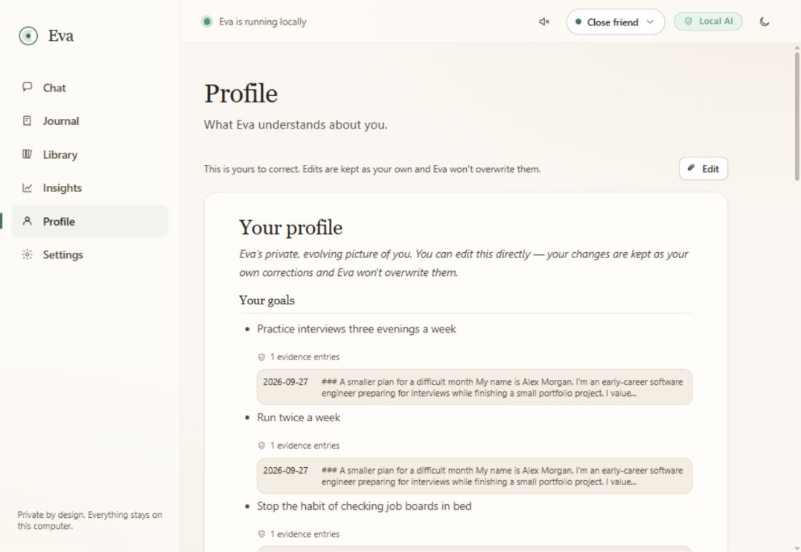
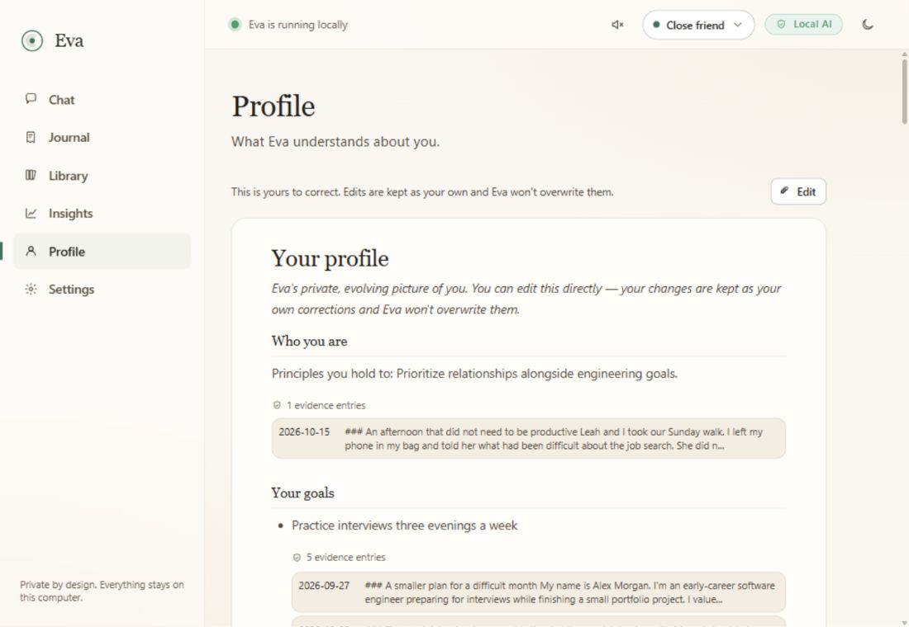
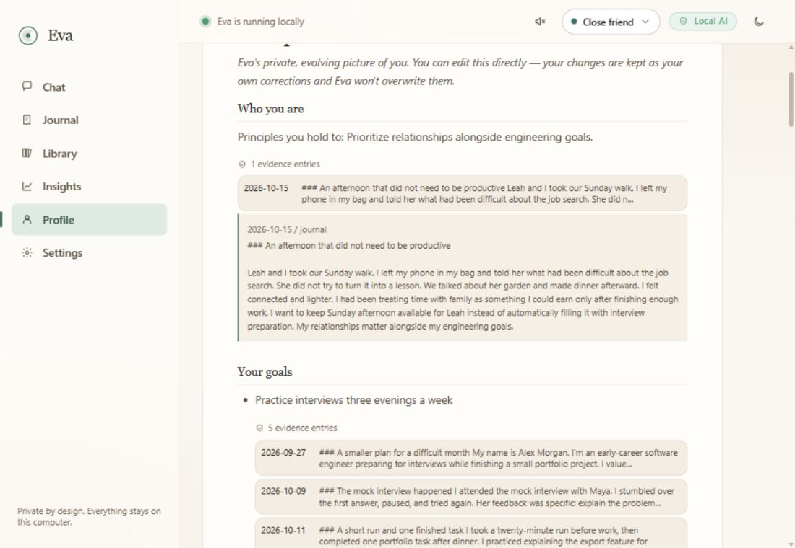
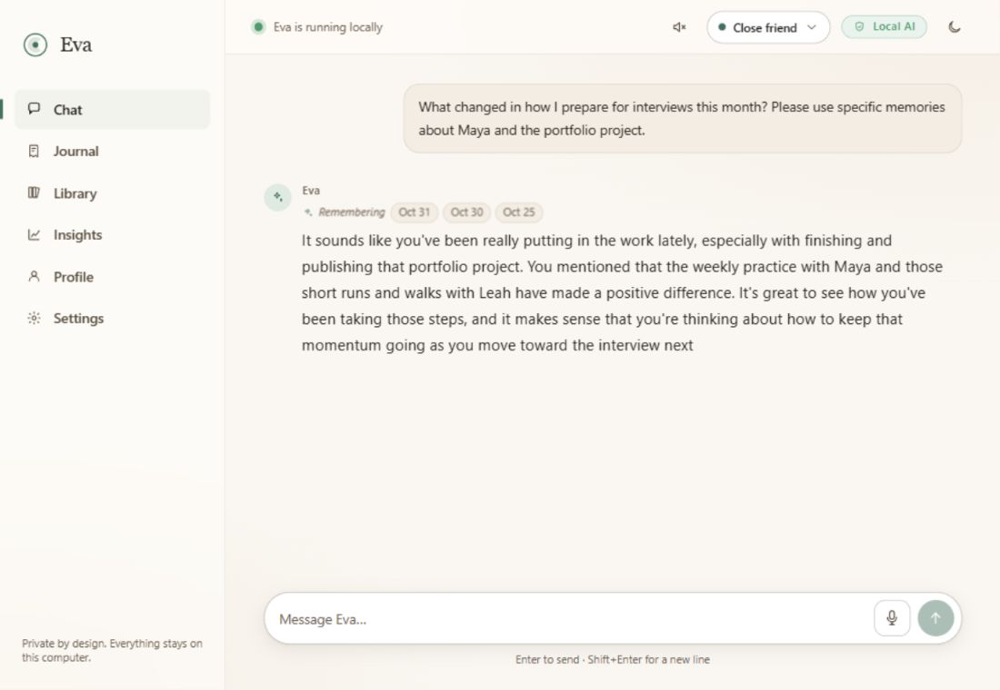
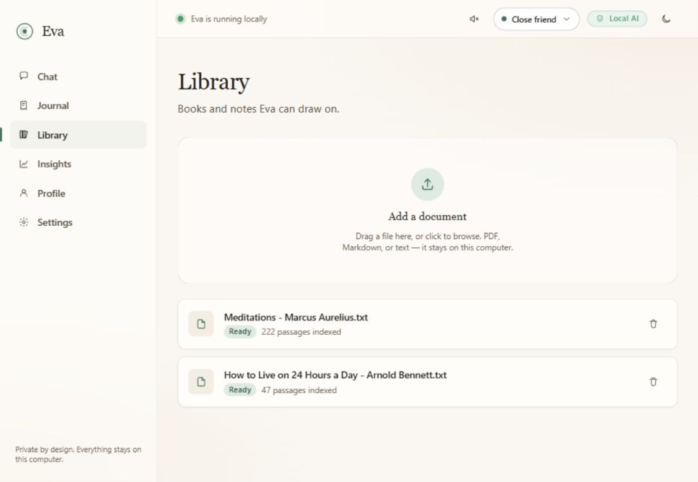
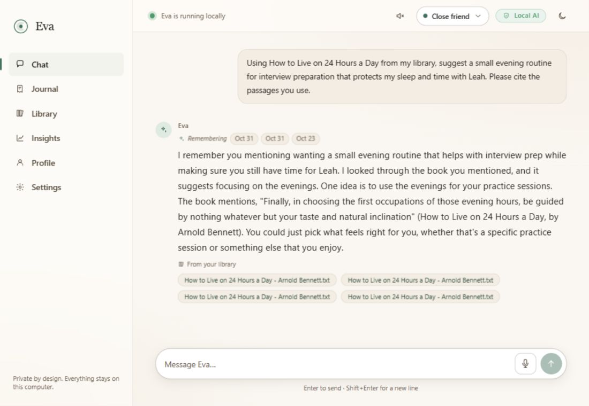
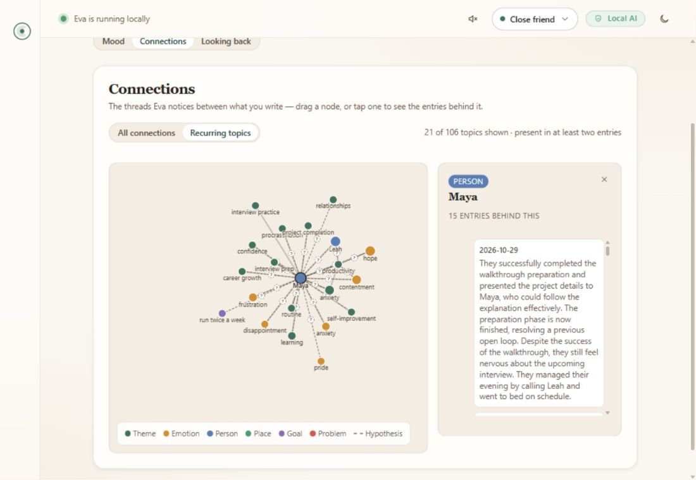
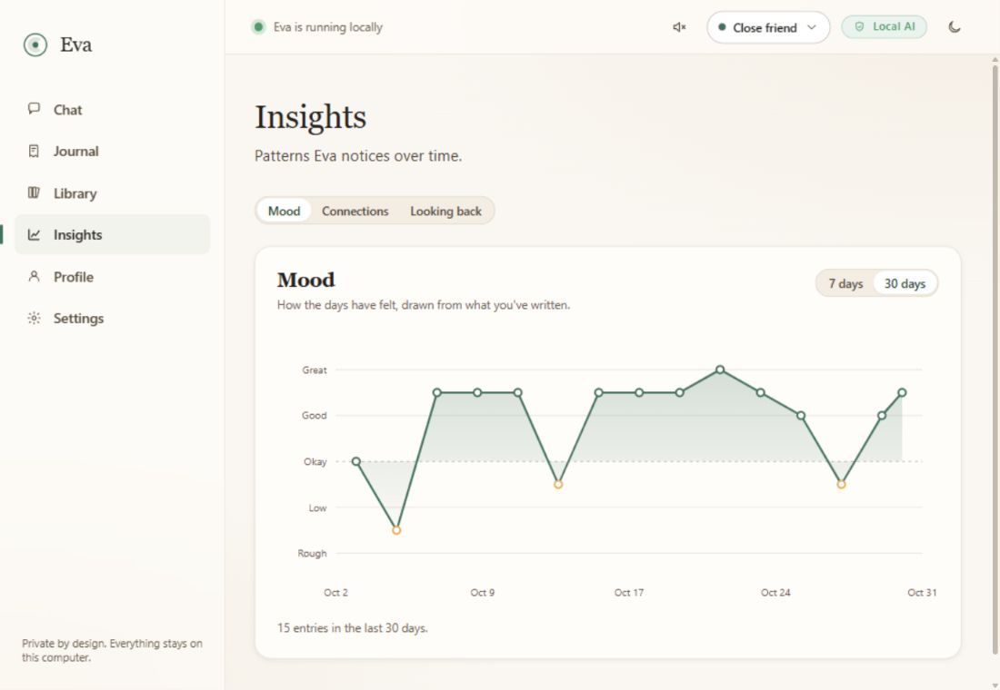
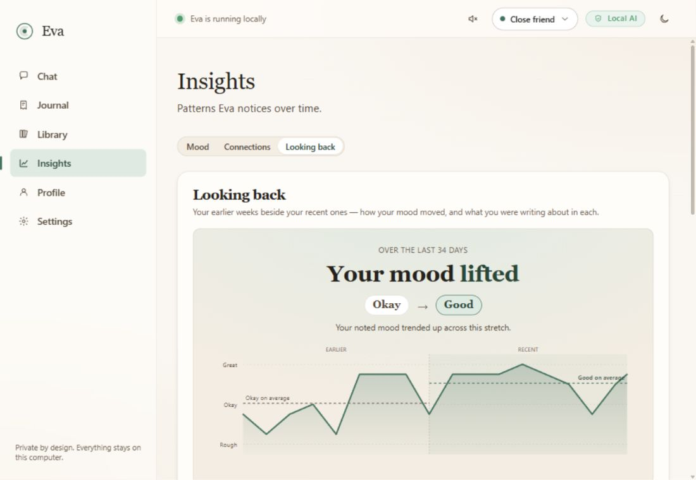

# Eva in practice: a small model with an evolving memory

**Demo recorded October 31, 2026 · screenshots captured October 31–November 1 · fictional persona · actual local model outputs**

Alex Morgan is an early-career software engineer preparing for interviews while
finishing a portfolio project. Over a simulated month, Alex writes about
overplanning, late-night job searching, mock interviews with Maya, and making
room for sleep, running, and time with their sister Leah.

The [18 journal entries](../scripts/fixtures/showcase_alex.json) are authored
fictional inputs. Eva's extractions, profile operations, evidence links, mood
values, and graph are computed by the real application and local Gemma model.
The screenshots below capture that running UI; they are not mockups.

## The engineering problem

A small local model cannot carry a person's entire history in each conversation.
Useful continuity also needs more than nearest-neighbor search: yesterday's
unresolved concern may be resolved today, and a mistaken interpretation must be
open to correction.

Eva separates those responsibilities. Original writing is durable Markdown.
Extraction produces structured episodes; local indexes support recall. A
background write loop proposes restricted profile operations with source-entry
IDs, and deterministic code validates and applies them. The conversational read
loop selects recent episodes, relevant memories, and eligible profile slices.
The model's weights stay fixed throughout.

This makes memory changes inspectable. It also leaves inference fallible:
an existing source ID enables an audit, rather than proving that a model's
interpretation of that source is correct.

Implementation: [capture](../backend/memory/capture.py),
[profile operations](../backend/memory/operations.py),
[consolidation](../backend/memory/consolidate.py), and the
[conversation engine](../backend/engine/turn.py).

## 1. Original writing stays accessible



The fixture builder writes backdated Markdown entries, indexes them, and calls
the same extraction and nightly consolidation functions used by Eva. It supplies
no prewritten profile, extraction JSON, or numeric mood series. Each original
entry keeps a stable ID for later evidence references.

## 2. New entries change the same profile

| Observed in this run | After 6 entries | After 18 entries |
| --- | --- | --- |
| Completed extractions | 6 | 18 |
| Evidence for the interview-practice goal | 1 entry | 5 entries |
| Principle about protecting relationships | Absent | Added, citing the October 15 journal |
| Open loop about replying to Maya | Open | Resolved, with later evidence |
| Typical mood derived from extracted values | −1 | +1 |
| Graph nodes derived from the journals | 46 | 106 |

These are recorded outputs from one staged example, not model-quality scores.
The [run record](showcase/run-record.json) contains the stage reports, actual
claim IDs, and source-entry mappings behind this table.

**Baseline: goals and the first evidence links.**



**Later: an additional principle and more supporting entries.**



**Inspect the claim against the original journal.**



The relationship principle points to Alex's Sunday walk with Leah. The UI opens
that entry directly so a reader can evaluate the interpretation and correct the
profile. User corrections become protected anchors.

## 3. Recall supports a later conversation



This is a real generated reply to a later question about Alex's month. The
memory chips identify the journal dates selected for the turn. Chat uses
retrieved context and selected profile claims; it does not retrain Gemma.

## 4. Books provide context for advice



The demo ingests [Meditations by Marcus Aurelius](https://www.gutenberg.org/ebooks/2680)
and [How to Live on 24 Hours a Day by Arnold Bennett](https://www.gutenberg.org/ebooks/2274)
from Project Gutenberg. Their text is downloaded during setup, then indexed
locally into 222 and 47 passages respectively. The books themselves are not
bundled into this repository.



Alex asks for an evening routine that preserves sleep and time with Leah.
Eva retrieves four passages from Bennett's book and exposes each through a
source chip. The quotation in this reply was checked against the third
retrieved passage. Plain-text uploads have no page numbers, so several chips
can share a filename while opening different passages.

The books supply perspectives the model can draw on when advice is requested.
They do not alter model weights or automatically replace Eva's friend, coach,
and mentor modes. Venting and processing turns continue to bypass the library.

## 5. Explore the connections and the changes



The full graph contains 106 nodes. This screenshot uses the visible
**Recurring topics** filter: 21 topics appearing in at least two entries.
Selecting Maya exposes 15 supporting entries. The full graph remains available;
dashed hypothesis links are tentative associations, not causal findings.





Mood and period comparisons describe the recorded writing. Their inputs are
model extractions, and they should be interpreted as reflection aids.

## What was verified

This run used Windows 11, Python 3.11.9, 32 GB RAM, and an RTX 5070 with 12 GB
VRAM. Native llama.cpp build `b11960` with its CUDA 13.4 runtime served
`gemma-4-E2B-it-qat-UD-Q4_K_XL.gguf`; the backend launched and supervised it.

- **433 backend tests passed**, including regression checks for concurrent
  initialization, advice-intent routing, failure drills, and safe fixture setup.
- The TypeScript/Vite production build and native Windows Tauri build passed.
- Both books were ingested through the real Library upload API.
- An offline speech check synthesized a sentence with Kokoro and transcribed
  it correctly with Whisper `base.en`, with the backend network guard active
  and zero recorded violations. Speech uses CPU/int8 in this installation.
- The Windows CPU setup path was checked separately in a fresh temporary folder.

Screenshots capture the running React UI through a browser at Eva's configured
1100 × 760 desktop size. The native Windows executable was separately built and
started. No private journals, credentials, host addresses, or model weights are
included in the showcase assets.

The 8 GB Apple Silicon target was not benchmarked in this run. This is an
integration demonstration, not a longitudinal study. One visible limitation is
that the model left the goal of asking Maya for a mock interview active even
after practice sessions occurred; evidence links make such stale interpretations
auditable. See the [technical paper](EVA_MEMORY_TECHNICAL_PAPER.md) for the broader
evaluation protocol and limitations.

## Reproduce the demo

Use a **fresh checkout and a separate vault**, never an existing personal vault.
Install the core dependencies and local model/embedding assets using the
[README setup steps](../README.md#run-locally), but prepare the fixture vault
before launching Eva. The builder refuses an unclaimed vault that already
contains journals, settings, a database, or a profile.

In PowerShell, from the fresh repository root:

```powershell
$demoPython = Join-Path (Get-Location) 'backend/.venv/Scripts/python.exe'
$demoVault = Join-Path (Get-Location) 'local_vault'
& $demoPython scripts/build_showcase.py --vault $demoVault --stage baseline --prepare-only
```

In a second terminal, start the showcase with automatic consolidation paused
while the builder drives the write loop. The CPU profile works with the runtime
installed by `setup_windows.ps1`:

```powershell
powershell -NoProfile -ExecutionPolicy Bypass -File scripts/run_showcase.ps1 -PauseConsolidation -LlamaProfile win-cpu
```

If you have installed the official CUDA binary **and its matching runtime DLLs**,
use `-LlamaProfile win-cuda` instead. The recorded run used the Windows x64
[binary and CUDA runtime archives from build b11960](https://github.com/ggml-org/llama.cpp/releases/tag/b11960).
The GPU profile retains the embedded Jinja template, disabled reasoning,
8,192-token context, q8_0 KV caches, and flash attention.

Back in the first terminal:

```powershell
& $demoPython scripts/build_showcase.py --vault $demoVault --stage baseline
# Inspect and capture the initial Profile before adding the next stages.
& $demoPython scripts/build_showcase.py --vault $demoVault --stage adjustment
& $demoPython scripts/build_showcase.py --vault $demoVault --stage current
```

The base date defaults to today so the charts remain current. To replay the
recorded dates, pass `--base-date 2026-10-31` consistently, including during
preparation. Model outputs and generated IDs can differ between runs.

Progress and stage snapshots live under the demo vault. Completed stages are
skipped on rerun; interrupted stages resume using the same saved entry IDs.
Use the normal Library uploader to add the two downloaded books, then try the
questions in the [fixture](../scripts/fixtures/showcase_alex.json).

After capturing the staged example, restart the showcase launcher without
`-PauseConsolidation` to restore normal scheduled memory updates. The ordinary
Eva development launchers remain available for a separate personal checkout.
